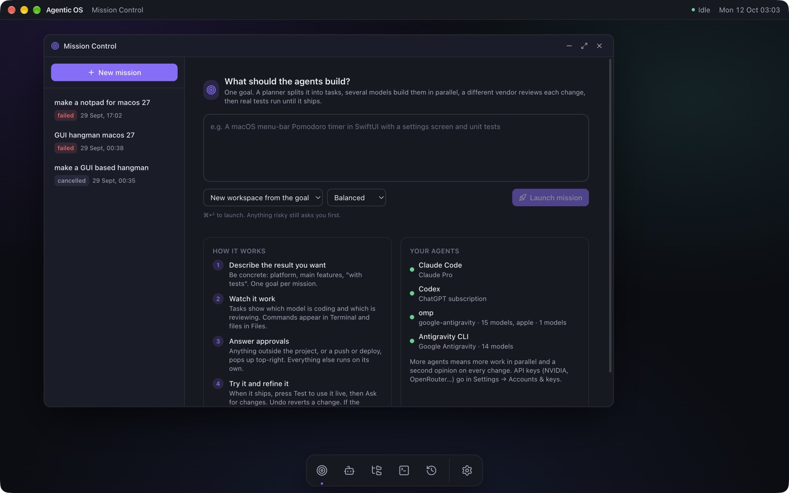
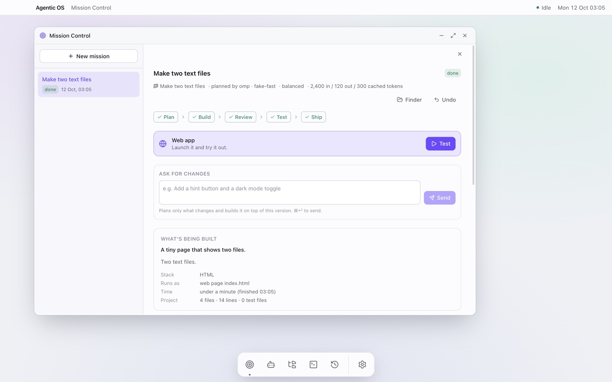
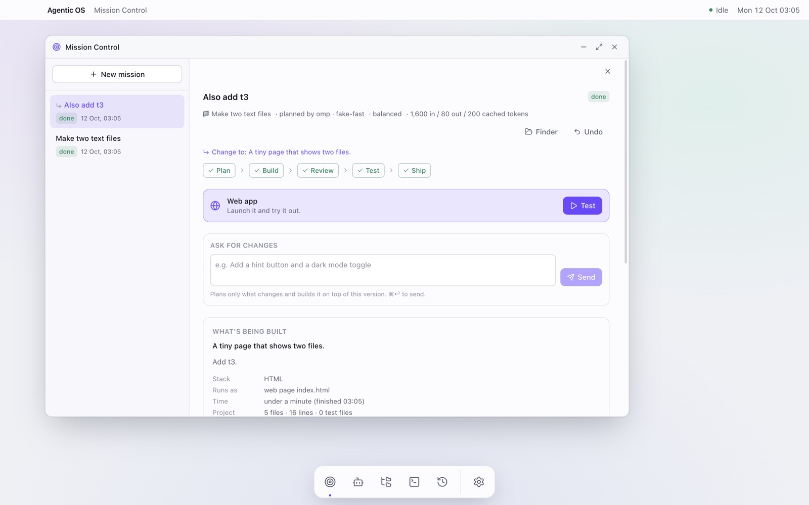
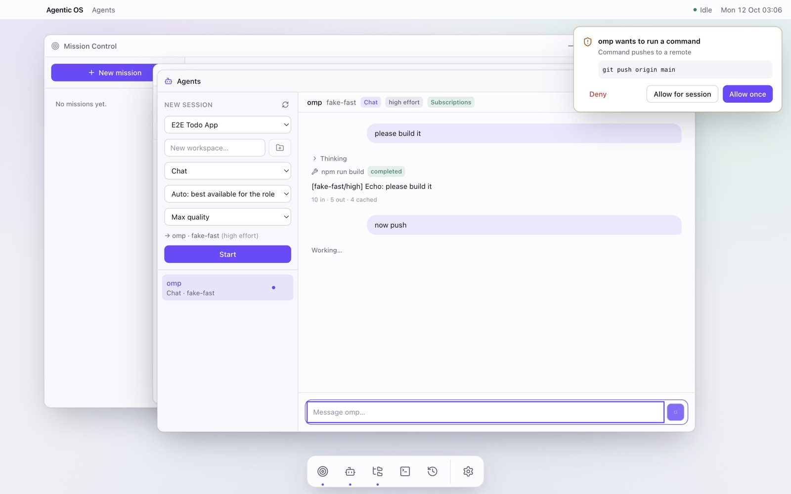
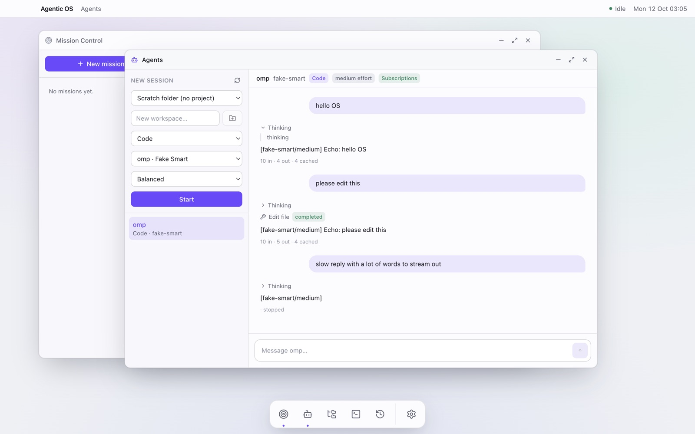
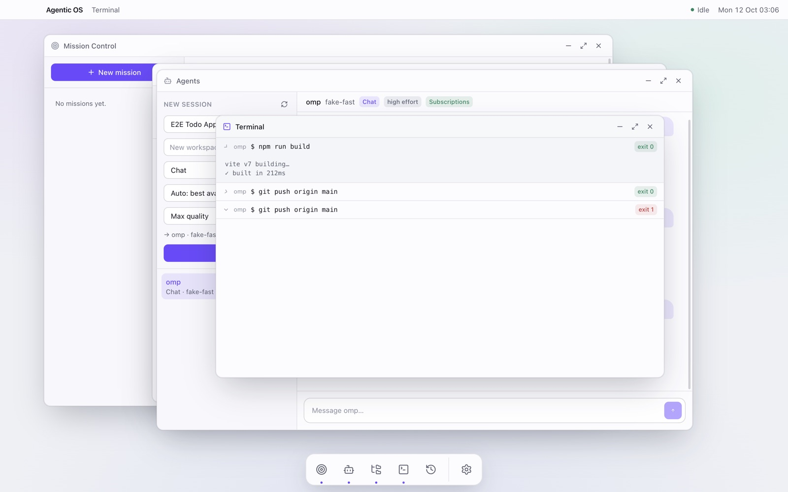
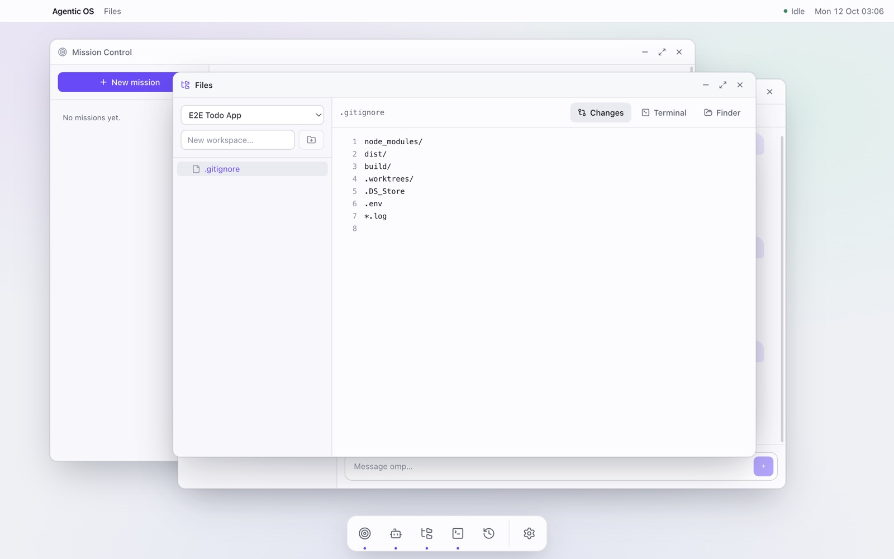
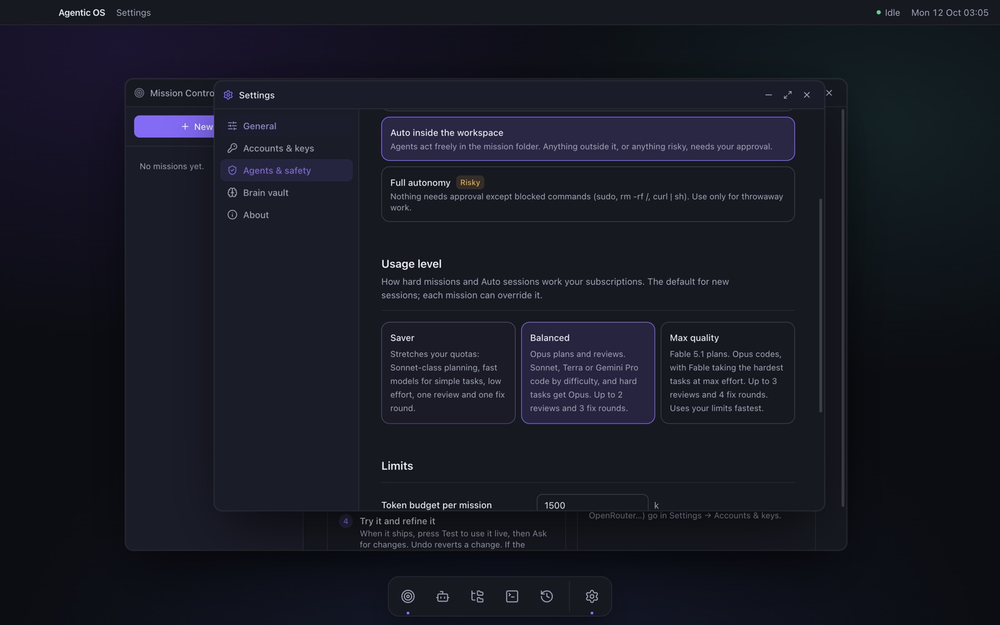
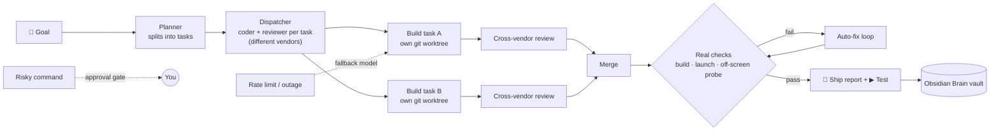

<div align="center">

# 🛰️ Agentic OS

**A macOS desktop "operating system" for AI agents.**
Describe a goal. Claude, GPT, Gemini, local Ollama models and CLI agents (Claude Code, Codex, omp) plan it, build it in parallel,
review each other's work across vendors, run real checks, and ship a finished project you can test with one click.

[-7c5cff?style=for-the-badge&logo=apple)](../../releases/latest)


<br>



*Mission Control: type a goal, pick a usage level, launch. "Your agents" shows the subscriptions that are signed in and ready.*

</div>

---

## Download

| | |
|---|---|
| **Agentic OS 0.1.0** | [`Agentic-OS-0.1.0-arm64.dmg`](../../releases/latest) from the Releases page |
| **Requires** | macOS on Apple silicon (built and used on macOS 27). Node ≥ 24 only if you build from source |
| **Not available for** | Windows or Linux builds (the electron-builder config targets macOS arm64 only; it relies on the macOS sandbox, Keychain and notifications) |

Open the DMG and drag **Agentic OS** to Applications. It isn't code-signed, so the first launch needs **right-click → Open**.
You'll need at least one agent: a Claude Code, Codex or omp subscription, an API key (Anthropic, OpenAI, Gemini, OpenRouter, NVIDIA NIM), or a local Ollama model.

## Screenshots

<table>
<tr>
<td width="50%"><br><b>A shipped mission</b>: plan → build → review → test → ship, with the ▶ Test button, product stack, run time and size</td>
<td width="50%"><br><b>Ask for changes</b>: the planner sees the existing product and plans only the change; Undo restores the previous version</td>
</tr>
<tr>
<td><br><b>Approval gate</b>: anything risky (here a <code>git push</code>) pops up for Deny / Allow once / Allow for session</td>
<td><br><b>Agents</b>: chat with any one model directly, with streaming, thinking and tool calls</td>
</tr>
<tr>
<td><br><b>Terminal</b>: every command an agent runs, with exit codes</td>
<td><br><b>Files</b>: the workspace's code and diffs</td>
</tr>
<tr>
<td colspan="2" align="center"><br><b>Agents & safety</b>: approval policy, usage level (Saver / Balanced / Max quality) and token budget per mission</td>
</tr>
</table>

## How a mission runs



## Proof

Both test suites pass on the 0.1.0 build:

```text
$ npm test
 Test Files  13 passed | 2 skipped (15)
      Tests  90 passed | 7 skipped (97)        # the 7 skipped are opt-in tests that spend real tokens

$ npm run test:e2e                             # builds, then drives the real Electron app with Playwright
  ✓ agents app routes, streams, and cancels
  ✓ a mission plans, builds in parallel, reviews, checks and ships
  ✓ desktop shell › boots with Mission Control open and a full dock
  ✓ desktop shell › windows open, focus, minimize, maximize and close
  ✓ desktop shell › dragging the title bar moves a window
  ✓ desktop shell › settings persist through the main process and SQLite
  ✓ desktop shell › API keys are stored but never readable from the renderer
  ✓ desktop shell › state survives a restart
  ✓ workspace, gated agent commands, terminal feed, approvals, files
  9 passed (26.2s)
```

The screenshots above (except Mission Control) were taken by that e2e run, driving the real app with a fake agent so no tokens are spent.

## Status

| # | Milestone | State |
|---|---|---|
| 0 | **Brain Sync**: every project, file, AI session and mission in one linked Obsidian graph | ✅ |
| 1 | **Desktop**: Electron shell, typed IPC, SQLite, settings, Keychain-encrypted keys | ✅ |
| 2 | **Agents**: subscriptions first (Claude Code, Codex, omp), then API keys (Anthropic, OpenAI, Gemini, OpenRouter, NVIDIA NIM), then Ollama. Self-updating model lists, role router, caveman-ultra and ponytail policies | ✅ |
| 3 | **Workspaces and safety**: git repos with a worktree per task, approval gate, macOS sandbox for shell commands, Terminal and Files apps, Max quality mode | ✅ |
| 4 | **Mission Control**: goal, then plan, then parallel build, then cross-vendor review, then merge, then real checks with an auto-fix loop, then a ship report. Falls back to another model when one fails | ✅ |
| 5 | **Memory**: missions and workspaces recorded in the Brain vault, and Run again resumes from committed work | ✅ |
| 6 | **Ship**: onboarding cards, app icon, signed-less `.dmg` (`npm run dist -w agentic-os-desktop`) | ✅ |

## Using it

1. **Install**: download `Agentic-OS-0.1.0-arm64.dmg` from [Releases](../../releases/latest), open it and drag the app to Applications. Or, from the repo, run `npm run dev`.
2. **Mission Control** (the first icon in the dock) is the main place to work. Type what you want built and press **Launch mission**. The "Your agents" card shows which subscriptions are ready. Click **Sign in…** for any that aren't.
3. While it runs, each task shows which model is coding and which is reviewing. **Terminal** shows every command that runs, and **Files** shows the code and the diffs.
4. If something risky or outside the project needs your OK, a card pops up top-right. Everything else runs on its own.
5. When it's done, click **▶ Test** to try the finished product live. Web apps open in a preview window, with their dev server started for you if they need one. Mac apps launch directly, and command-line tools open in Terminal. **Stop** shuts it down. The "What's being built" card shows the product, stack, how it runs, how long it took and the project size. Click a task to see its spec and acceptance criteria. If a mission failed, **Run again** continues from what was already built.
6. The **Agents** window is for chatting with one model directly. It isn't needed for missions.

**Refine and recover:**
- **Ask for changes.** Under a finished mission, describe a change ("add a hint button"). The planner sees the existing product and plans only what changes; the result keeps the same Test button. **Undo** puts the project back to the version before the newest change (saved as a new commit, so nothing is lost).
- **Pause / Resume.** Pause stops after the agents' current step. No tokens are used while paused.
- **Internet drops.** The mission pauses instead of failing or burning through fallback models, and you get a notification. It resumes by itself the moment macOS reports the network is back, retrying the same task on the same model from the files already written. **Resume now** retries immediately.
- **Crashes and restarts.** A mission interrupted by quitting, a failure or Cancel can be **Resumed**. Finished tasks are kept and only the rest is redone.

Products are graphical by default: a game or app becomes a polished web app (plain HTML, CSS and JS, with no build step) unless you ask for a CLI or a native Mac app. Verification doesn't stop at a passing build. The product must actually launch (its entry file must exist, or its server must answer). Web apps are then opened off-screen once, and any script error, missing file or blank page is sent back to the fixer, just as a user would have hit it.

Parallel tasks each own their files (the plan says which), so merges rarely conflict.

When the app isn't in front, you get a macOS notification if a mission finishes or fails, or if an agent needs your approval. Mission Control won't launch if no agent can plan right now; it tells you what to sign in to first.

Settings → Agents & safety has the approval policy, the token budget per mission, and the **usage level**, which each mission can override:

| Level | Planning | Coding (by task difficulty: light / normal / hard) | Review · fix rounds |
|---|---|---|---|
| **Saver** | Sonnet, medium effort | Haiku / Sonnet / Sonnet, low effort | 1 · 1 (light tasks skip review) |
| **Balanced** | Opus 5.5, high effort | Haiku / Sonnet / Opus | 2 · 3 |
| **Max quality** | Fable 5.1, max effort | Sonnet / Opus / Fable 5.1 | 3 · 4 |

**How a mission's team works:**
- **Dispatcher.** After planning, one call to a cheap model (Gemini Flash-Lite on omp; Haiku if omp is signed out) assigns a coder and reviewer to each task. It chooses only from models the router has already checked are available and suited to the task. It spreads parallel tasks across subscriptions and keeps each reviewer on a different vendor from its coder.
- **Briefs and hand-offs.** When a task is assigned, its agent gets the team roster (who is doing what, on which model) plus the hand-off notes of the tasks it builds on. Each coder ends with a note (what it did and which files it touched), which goes to the reviewer, later tasks, the fixer and the ship report. Agents don't message each other while they work, which keeps token use low.
- **Limits.** If a model hits a rate or usage limit, runs out of credits, or turns out to be unavailable, the next-best available model takes over, even mid-task, continuing from the same files. That subscription is rested for 15 to 60 minutes. Auto chats in the Agents window switch too, carrying a recap of the conversation.

The same tiers apply to every provider (Codex Terra/Luna, omp's Claude and Gemini, APIs, NVIDIA, Ollama). Work spreads across your subscriptions, and a model that fails or runs out of quota is replaced automatically.

## Develop

```sh
npm install
npm run dev          # launch the app with hot reload
npm test             # unit tests (brain-sync + desktop)
npm run test:e2e     # builds, then drives the real Electron app with Playwright
npm run typecheck
AOS_REAL_AGENTS=1 npx vitest run test/integration -w agentic-os-desktop   # opt-in: spends a few tokens on each subscription
```

Requires Node ≥ 24 on macOS. npm 11 blocks install scripts by default. Only `esbuild` is approved (see `allowScripts` in `package.json`). Electron downloads its binary on first run.

### Desktop architecture (`apps/desktop`)

- `src/main/`: the kernel. `store/db.ts` uses the SQLite built into Node (`node:sqlite`, so no native rebuilds) and append-only migrations. `store/settings.ts` holds validated settings. `store/secrets.ts` holds API keys encrypted with Electron `safeStorage` (a Keychain-held key). The plaintext never crosses IPC. `ipc.ts` validates every renderer call.
- `src/shared/ipc.ts`: the one typed contract. The preload builds `window.aos` from its channel list, so the UI and the main process can't drift apart.
- `src/renderer/`: React 19, Tailwind 4 and zustand. The `shell/` folder has the window manager, dock and menu bar. The `apps/` folder has one component per OS app.
- Security: `sandbox`, `contextIsolation`, no `nodeIntegration`, a CSP in production builds, no in-app navigation, and only https links open externally.
- Test hooks: `AOS_USER_DATA` points the app at an isolated profile. In dev builds only, `AOS_INSECURE_SECRETS=1` skips the Keychain for e2e runs.

### Agents (`src/main/agents`)

- `router.ts` assigns each role (plan, code, review, test, summarize, chat) to the best available model. It tries subscriptions first, then API keys, then local models. Planning and review get the strongest model, routine work gets a fast one, and review goes to a different vendor than the one that wrote the code.
- `policies.ts` gives every agent your installed **caveman** skill at `ultra` level. Code-writing roles also get **ponytail**. The prompt text stays byte-identical between sessions so provider caches hit (measured: 12.3k of 12.3k input tokens came from cache on Claude).
- Power: the UI gets batched updates (80 ms), idle agents are shut down after 10 minutes, Codex runs one process per turn, and model lists are cached for 24 hours. Nothing polls.
- Gemini runs through Google's **Antigravity CLI (`agy`)** in headless mode, one process per turn, confined by the macOS sandbox. omp's `google-antigravity` models are the backup. Both draw on the same Antigravity quota, so the router treats them as one pool.

Shortcuts: `⌘1`–`⌘6` open apps, `⌘,` opens Settings, `⌘W` closes the focused window. Double-click a title bar to maximize.

## Ideas taken from other agentic tools

What we borrowed, and how it fits Agentic OS's priorities (simple to operate, easy on the battery, careful with tokens):

| Idea | Seen in | Here |
|---|---|---|
| Follow-up prompts on a live app, with version history | Lovable, bolt.diy, Dyad | Ask for changes + Undo (git-backed) |
| Feed the app's own runtime errors back to the model | bolt.diy (WebContainer) | Hidden page probe in the launch check |
| Resume from saved state after a crash or disconnect | OpenHands (event store replay), AGX checkpoints | Resume keeps merged tasks; offline pause auto-resumes |
| One file, one owner for parallel agents | Addy Osmani, *The Code Agent Orchestra* | `files` per task in the plan |
| Worktree per agent, reviewer ≠ author | parallel-code, Emdash, Claude Squad | Already core; cross-vendor review |
| Zero-token coordination | bernstein | Scheduling, merging and checks are plain code; only the dispatcher is a (cheap) model call |

Not adopted, on purpose: Kanban boards and multi-pane terminals (more to operate), mobile push relays (always-on network), GPU-accelerated terminals (battery).

---

Made by **Kamalesh VS** · [github.com/kkjjkamal123](https://github.com/kkjjkamal123) · [kkjj.me](https://kkjj.me)
